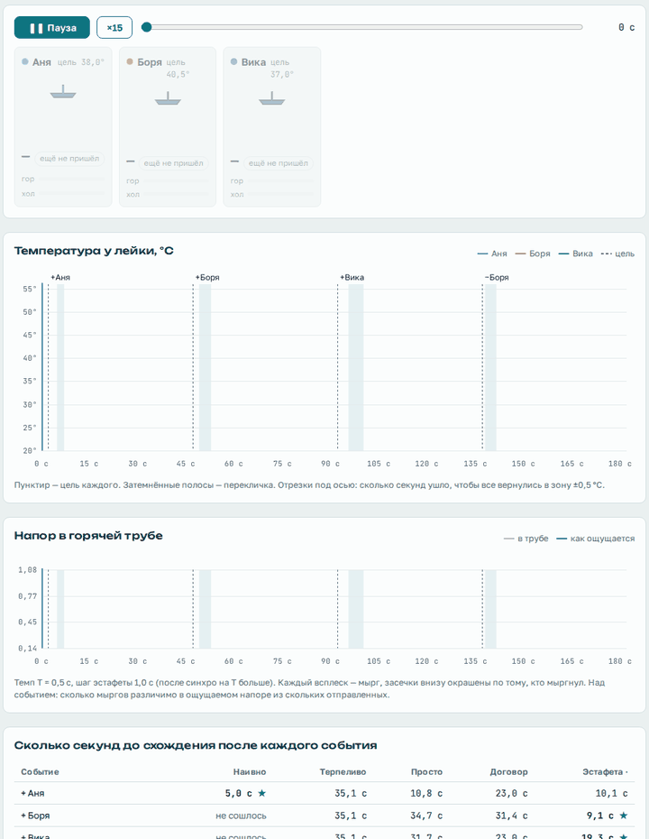

# A protocol for showers on a shared hot-water line

Several showers share one hot-water line. When one person turns their tap, the pressure, and a few
seconds later the temperature, changes for everyone else. They all adjust, which changes it again, and
everybody ends up chasing everybody. You can't talk, temperature reaches you with a ~5 s delay, people
come and go, and the right tap setting depends on how many people are showering right now (N).

This repo is a simulator and an interactive page that compare several ways out of that trap, from
"just nudge the cold tap slowly" to a relay protocol that signals with pressure blinks and counts N.



The story of how it was built (with Claude, and why a dumb rule turned out to be almost as good) is in
[ARTICLE.md](ARTICLE.md). The full technical write-up, with every table and known limitation, is in
Russian: [README.ru.md](README.ru.md). The interactive page is in Russian too.

## Strategies

| Strategy | What people do |
|---|---|
| `naive` | Everyone tweaks the hot tap every second. Never converges with two or more people. |
| `patient` | Hot tap on a shared mark, small cold-tap moves, wait out the water delay between them. ~35 s. |
| `simple` | Hot tap on the mark. About once a second (±30 % random jitter) move the cold tap by a small fraction of the error, at most 3 % of its range; ignore errors under 0.3 °C. No signals, no N. |
| `sheet` | Five rules on the wall plus a clock: when the pressure jumps, blink at *stall number × S* seconds, count the blinks, set the cold tap from a table for that N, then nudge. |
| `relay` | Pressure signals (a *blink* = close the hot tap for T), a relay roll call (No. k blinks as soon as it hears No. k−1), a jump to a personal table setting for the new N, then Newton corrections. Handles merged syncs, draws lots for duplicate numbers, jam signal as a fallback. Close to Ethernet's CSMA/CD and the "beeping model". |

## Results

`node tools/compare.js`, 100 seeds per row, water delay L = 5 s, an arrival or departure every 45 s.
Median time to converge / share of events that didn't converge before the next one.
P is how long a pressure change takes to reach you.

| | simple | sheet | relay |
|---|---|---|---|
| P = 0.5 s, N = 2 / 4 / 6 | 33 / 32 / 32 s; 0 / 0 / **27 %** | 23 / 29 / 29 s; 0 % | 10 / 15 / 19 s; 0 % |
| P = 2 s, N = 2 / 4 / 6 | same (doesn't use pressure) | 34 / 36 / 36 s; **26 / 48 / 65 %** | 13 / 21 / 24 s; 0 % |
| P = 2 s, events every 90 s | 33 / 32 / 34 s; 0 % | 36 / 36 / 43 s; 0 % | 13 / 20 / 24 s; 0 % |
| water delay L = 3 / 8 / 12 s (N = 4) | 33 / 40 / — s; 0 / **76 / 100 %** | 0 / 4 / 46 % | 13 / 21 / 29 s; 0 % |
| six people, two / three arrive at once | 18 / 22 % | 0 % | 0 / 1 % |
| discomfort, six people, P = 0.5 s (°C·s each) | 234 | 241 | 185 |

The relay wins on raw numbers, but read the caveat below: several of its parts read the simulator's
true state instead of what a person could feel. The simple rule needs no agreement at all and breaks
only with many people or long pipes; the wall sheet is the middle ground a human could follow.

## Where the agents know more than they could

These parts of `relay` read the true state, so their numbers are assumptions, not results: the early
jump takes N from the people present; the blink threshold uses the true head count; everyone shares one
identical perception of pressure; "hearing" another person's sync comes from the simulator's roll-call
state; the Newton step takes its slope from the true state of all taps. The honest parts: counting
blinks from felt pressure, double-sync detection by dip area and the lot drawing, the jam signal,
collision detection by temperature, and detecting an arrival mid-roll-call. Details in
[README.ru.md](README.ru.md#допущения-модели-где-агенты-знают-больше-чем-могли-бы).

## Files

| File | What it is |
|---|---|
| `sim.js` | the simulator (`ShowerSim.simulate(opts)`), runs in the browser and in node |
| `index.html` | interactive page: sliders, temperature and pressure charts, a comparison table |
| `tools/compare.js` | final comparison of simple / sheet / relay, checking everyone's N before each event |
| `tools/strategies.js` | naive / patient / simple / relay on a few configurations |
| `tools/sweep.js` | batch runs without a GUI: strategies, delay, interval, ablations, pairs, tempo, merges, triples, noise, simple, sheet |
| `tools/pair-sweep.js` | "two arrive almost together" over N, P and the gap between them |

## Running

```bash
npm run serve          # then open http://localhost:8000
npm run strategies
npm run sweep          # all quick sets; or: node tools/sweep.js strategies,tempo 100
node tools/compare.js relay N=6,P=0.5,gap=45
```

No dependencies, just node and a browser.

## License

MIT, see [LICENSE](LICENSE).
